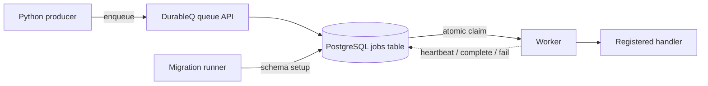
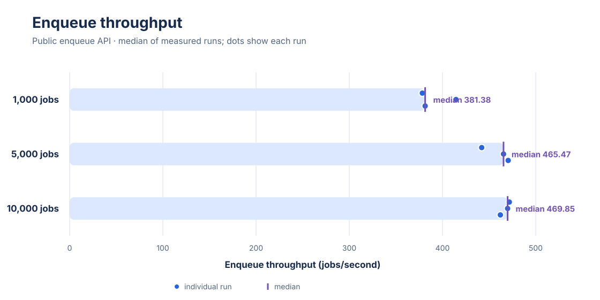
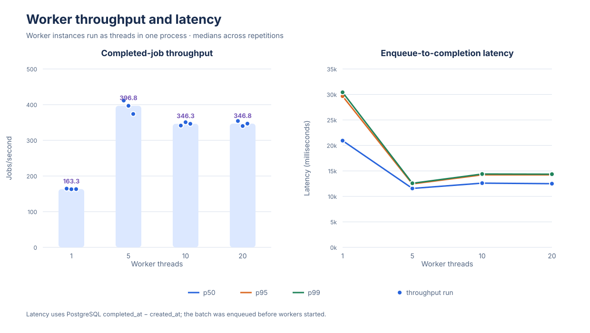

# DurableQ

DurableQ is a Python background job queue backed by PostgreSQL. It provides durable job storage, concurrent claiming, retries, delayed execution, lease recovery, and worker coordination using PostgreSQL transactions and row locks.

DurableQ is a compact v1 implementation and engineering project. The benchmark results are workload- and environment-specific; this README does not claim production readiness.

## 1. Project Overview

DurableQ moves work out of a request or process lifetime and stores it in PostgreSQL. Producers enqueue JSON jobs; workers claim eligible work, run registered handlers, and report completion or failure. If a worker exits unexpectedly, a later claim can recover the job after its visibility lease expires.

## 2. Problem Statement and Motivation

Work performed inside a request or short-lived process can be lost when that process exits, and long tasks can tie up request handling. A background queue provides durable scheduling and retry behavior while allowing request handlers and other producers to return promptly.

DurableQ uses PostgreSQL as both the job store and coordination layer. This keeps queue state in a transactional database and avoids requiring another service for the v1 implementation. PostgreSQL is a practical fit for workloads that value durable job state and a smaller service footprint; it is not intended to match specialized queue systems at every scale.

## 3. Key Features

- JSON object payloads and an enqueue API with optional idempotency keys.
- Delayed execution through timezone-aware `run_at` values.
- Atomic concurrent claiming with PostgreSQL `FOR UPDATE SKIP LOCKED`.
- Visibility leases, heartbeat renewal, and recovery of abandoned jobs.
- Attempt and worker fencing for heartbeat, completion, and failure updates.
- Exponential retry backoff with jitter and dead-letter handling.
- Cooperative cancellation after detected lease loss.
- Ordered, transactional migrations with schema validation and legacy-schema adoption.
- Read-only queue metrics from one PostgreSQL aggregate query.
- Docker Compose setup for PostgreSQL, migrations, and a demo worker.

## 4. Architecture

PostgreSQL stores job state and coordinates workers. The queue API writes jobs and claims them in short transactions. A worker runs the handler after the claim transaction has ended; heartbeat and state transitions use separate database operations.



## 5. Job Lifecycle

```mermaid
stateDiagram-v2
    [*] --> Queued
    Queued --> Running: eligible claim, increment attempt, set lease
    Running --> Completed: handler returns and lease is valid
    Running --> Queued: handler fails; retry is scheduled
    Running --> Dead: handler fails after attempts are exhausted
    Running --> Running: lease expires, a later claim replaces the owner
    Queued --> Dead: exhausted job is cleaned up by a later claim
```



The `status` field describes persisted queue state. An expired running job remains `running` until a later claim reclaims it or moves it to `dead` after its attempts are exhausted.

## 6. Core Engineering Design

### Atomic claims

`claim()` selects an eligible queued or expired running job using `FOR UPDATE SKIP LOCKED` and updates the selected row to `running` in the same transaction. Concurrent claimers skip rows already locked by another transaction. A claim increments `attempts`, sets `worker_id`, and advances `visible_at` by the visibility timeout. Handler execution occurs outside the claim transaction.

### Visibility timeout and fencing

`visible_at` is the next eligibility time for queued jobs and the lease deadline for running jobs. Heartbeats extend a live lease. Heartbeat, completion, and failure first lock the matching job row, then check the lease using PostgreSQL time. Updates also verify job ID, attempt number, running status, and worker ID, so an expired or reclaimed worker cannot change the current database state.

### Retry and dead-letter policy

Enqueue defaults to `max_attempts=3`. `fail()` defaults to exponential backoff beginning at 2 seconds and doubling by attempt, capped at 300 seconds. It chooses a random delay between half the calculated delay and the capped delay. A failure on the final attempt marks the job `dead`; a later claim also moves an abandoned job to `dead` when its attempts are exhausted.

### Delayed jobs

Pass a timezone-aware `datetime` as `run_at` to `enqueue()`. DurableQ stores the time in `visible_at`; the job becomes eligible when that timestamp is no later than the database clock. A past `run_at` is immediately eligible.

### Idempotent enqueue

For a non-NULL `idempotency_key`, a partial unique index prevents duplicate rows. Enqueueing the same key again returns the existing job's ID, type, and status. It does not replace the original payload, attempt limit, or schedule. Idempotency deduplicates enqueue requests; it does not guarantee exactly-once execution.

## 7. Delivery Guarantees and Reliability

DurableQ provides **at-least-once delivery**. A handler can perform an external side effect and then exit before the queue records completion. After the lease expires, another worker may run the handler again. Make handlers idempotent or use application-level deduplication when repeated external effects are unacceptable. DurableQ does not provide exactly-once execution.

Handlers can opt into cooperative lease-loss cancellation with `CancellableHandler`, which passes a `threading.Event` to the handler. The worker sets the event when heartbeat reports lease loss or fails. Cancellation is cooperative: handlers must observe the event and stop their own work. Python cannot safely force-kill arbitrary running threads, non-cancellable I/O may continue, and cancellation cannot undo side effects already performed.

Normal worker shutdown handles `SIGINT` and `SIGTERM` by stopping new polling and waiting for active synchronous work to return. A handler that blocks indefinitely can delay shutdown until the container's configured grace period expires.

## 8. Installation and Quick Start

### Requirements

- Docker Engine and Docker Compose v2.
- OpenSSL for generating a local URL-safe database password.

Copy the example environment file and replace its safe placeholders. Use the same generated value for `POSTGRES_PASSWORD` and the password in `DATABASE_URL`:

```sh
cp .env.example .env
openssl rand -hex 24
```

The database hostname in `DATABASE_URL` must be `db` for Compose networking. Keep `.env` private; it is ignored by Git and excluded from the Docker build context.

Start PostgreSQL, apply migrations, and start the demo worker:

```sh
docker compose up --build
```

Compose waits for the database health check, runs the migration service, and starts the worker only after migrations succeed. View worker output with `docker compose logs -f worker`. Stop the services with:

```sh
docker compose down
```

The named `durableq_postgres_data` volume persists database data across `docker compose down`. The local Compose configuration uses a PostgreSQL superuser for convenience and is not a production deployment configuration.

## 9. API Usage Examples

### Enqueue a job

```python
from datetime import UTC, datetime, timedelta

from app.queue import enqueue

job = enqueue(
    job_type="report.generate",
    payload={"report_id": 42},
    idempotency_key="report-42-generation-v1",
    run_at=datetime.now(UTC) + timedelta(minutes=5),
)
job_id, job_type, status = job
```

`enqueue()` returns `(job_id, job_type, status)`. For the same non-NULL idempotency key, a later call returns the existing job; its payload and schedule remain unchanged. Set `DATABASE_URL` for the target PostgreSQL database before calling the API.

### Run a custom handler

`Worker` accepts a mapping from job type to a one-argument handler. Register the handler in your application and run the signal-aware loop from the main thread:

```python
from app.worker import Worker, run_worker_with_signals


def generate_report(payload: dict) -> None:
    report_id = payload["report_id"]
    print(f"Generating report {report_id}")


worker = Worker(
    worker_id="reports-worker-1",
    handlers={"report.generate": generate_report},
    poll_interval_seconds=1,
    visibility_timeout_seconds=60,
)
run_worker_with_signals(worker)
```

The built-in Compose worker registers only the example `demo.log` handler. It requires an object payload with a non-empty string `message` and logs a processing event without logging the message contents. It is a demo handler, not production business logic. With Compose running, enqueue one using the public API:

```sh
docker compose exec worker python -c 'from app.queue import enqueue; print(enqueue("demo.log", {"message": "Hello from DurableQ"}))'
```

## 10. Metrics API

`get_queue_metrics()` runs one read-only aggregate query and returns exactly these fields:

| Field | Meaning |
| --- | --- |
| `total_jobs` | All rows in the jobs table |
| `queued_jobs` | Jobs currently stored as `queued` |
| `running_jobs` | Jobs stored as `running`, including expired leases not yet reclaimed |
| `completed_jobs` | Jobs currently stored as `completed` |
| `dead_jobs` | Jobs currently stored as `dead` |
| `eligible_jobs` | Queued jobs whose `visible_at` is no later than database statement time |
| `oldest_queued_age_seconds` | Age of the oldest queued job by `created_at`, or `None` if there are no queued jobs |

```python
from app.metrics import get_queue_metrics

metrics = get_queue_metrics()
print(metrics["eligible_jobs"], metrics["oldest_queued_age_seconds"])
```

This is a Python API. The project does not include an HTTP endpoint or Prometheus exporter.

## 11. Database Schema and Migrations

[`app/schema.sql`](app/schema.sql) describes the complete current `jobs` table. Runtime setup uses the ordered SQL migrations:

1. [`001_initial_schema.sql`](migrations/001_initial_schema.sql) creates the table, original constraints, and indexes.
2. [`002_job_state_constraints.sql`](migrations/002_job_state_constraints.sql) adds the worker-assignment, completion-timestamp, and JSON-object payload constraints.

The migration runner takes a PostgreSQL advisory transaction lock, validates the required columns, constraints, and indexes for each migration version, and records each migration in the same transaction as its SQL. It can adopt a compatible legacy schema and fails on incompatible schemas without silently repairing or dropping existing job data.

Run migrations for the database configured by `DATABASE_URL` with:

```sh
python -c "from app.migrate import run_migrations; print(run_migrations())"
```

Compose runs the same migration runner before starting the worker.

## 12. Testing and Verification

Tests require PostgreSQL but can run independently of Docker Compose. Install the pinned CI and test dependencies:

```sh
python3 -m pip install -r requirements-ci.lock
createdb durableq_test
export TEST_DATABASE_URL="postgresql://localhost/durableq_test"
export TEST_DATABASE_ALLOWED_HOSTS="localhost"
```

The test role must be able to connect to the dedicated test database and have `CREATEDB`. Migration tests create and clean up uniquely named disposable databases. The guard requires a test-marked database name and an explicitly allowlisted host, and rejects missing, production-like, or unrecognized hosts before destructive fixtures run. Never point `TEST_DATABASE_URL` at a production or development server.

Initialize the root test database schema and run the suite:

```sh
DATABASE_URL="$TEST_DATABASE_URL" python3 -c "from app.migrate import run_migrations; run_migrations()"
python3 -m pytest
```

### Verified evidence

- **Latest full-suite run:** 139 passed in 9.34 seconds on a fresh isolated PostgreSQL 16.16 database using Python 3.13.3 and psycopg 3.3.6. This run used the existing local virtual environment. The CI lock (`requirements-ci.lock`) pins psycopg 3.3.9, so the local run did not use the lock-pinned psycopg version.
- The focused benchmark-validation test reported **1 passed in 0.02 seconds**.
- The Docker Compose end-to-end smoke test enqueued a `demo.log` job through the public API and verified it completed with one attempt. The worker log did not expose its payload.
- GitHub Actions workflow configuration exists, but no hosted run has been verified.

## 13. Performance Benchmarks

The charts below are generated from the raw repetitions in [`benchmarks/results.json`](benchmarks/results.json) by [`benchmarks/plot_results.py`](benchmarks/plot_results.py). See [`benchmarks/README.md`](benchmarks/README.md) for isolation, workload, and execution details. Regenerate the charts from the repository root with `python3 benchmarks/plot_results.py`.





| Enqueue batch | Median throughput (jobs/second) |
| ---: | ---: |
| 1,000 | 381.38 |
| 5,000 | 465.47 |
| 10,000 | 469.85 |

| Worker threads | Median throughput (completed jobs/second) | Median per-run p50 (ms) | Median per-run p95 (ms) | Median per-run p99 (ms) |
| ---: | ---: | ---: | ---: | ---: |
| 1 | 163.28 | 20,940.06 | 29,671.12 | 30,421.08 |
| 5 | 396.81 | 11,563.87 | 12,449.01 | 12,578.09 |
| 10 | 346.32 | 12,601.50 | 14,229.31 | 14,393.37 |
| 20 | 346.80 | 12,495.22 | 14,225.00 | 14,362.46 |

The benchmark measured 60,000 worker jobs across three repetitions at four concurrency levels. It used PostgreSQL **16.16** on an **Apple M1 with 8 logical CPUs and 8 GiB RAM**. PostgreSQL's data directory was on a **2 GiB tmpfs**. Worker concurrency was measured with multiple `Worker` instances running as threads in one process, not as separate processes. Latency is PostgreSQL `completed_at - created_at`; the worker batch was fully enqueued before workers started, so latency includes waiting while the rest of that batch was enqueued. Each table latency value is the median of that percentile across the three repetitions. These measurements are specific to this environment and workload, not general capacity claims; tmpfs results do not represent durable disk-write performance.

## 14. Limitations

- Delivery is at least once. External side effects can happen more than once after a crash or lease expiry.
- Cancellation is cooperative. An event-ignoring handler or non-cancellable I/O can continue after lease loss; Python cannot safely force-kill arbitrary handler threads.
- The Compose setup uses a PostgreSQL superuser and is intended for local demonstration, not production deployment.
- The demo handler is not application business logic. Metrics are exposed as a Python API, not an HTTP service.
- The benchmark uses a lightweight handler, one host, in-process threads, and tmpfs-backed PostgreSQL storage. It does not establish production capacity.
- This project does not claim production readiness.

## 15. Future Improvements

Potential next steps include an HTTP metrics exporter, structured logging, broader failure-injection and Hypothesis coverage, richer per-job retry and visibility settings, and benchmarks with separate worker processes and durable storage.

See [design decisions](docs/design-decisions.md) for concise implementation rationale and tradeoffs.

## License

DurableQ is distributed under the [MIT License](LICENSE).
